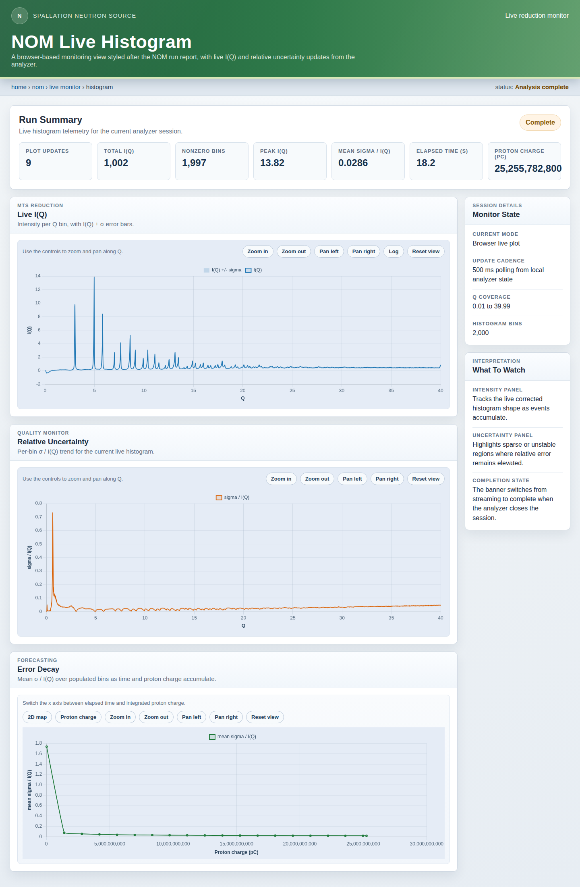

# live stream analysis

[](https://github.com/neutrons/live_stream_analysis/actions/workflows/test_and_package.yaml?query=branch%3Amain)
[](https://github.com/neutrons/live_stream_analysis/actions/workflows/publish-to-ghcr.yml?query=branch%3Amain)
[](https://www.python.org/downloads/)
[](https://opensource.org/licenses/BSD-3-Clause)

Live reduction of neutron diffraction data from [NOMAD](https://neutrons.ornl.gov/nomad) at the
Spallation Neutron Source: turn events into a corrected I(Q) while the run is still counting, and
track how fast its uncertainty falls.



- **Three sources, one pipeline:** a live ADARA stream from the beamline, a recorded ADARA file,
  or a completed event NeXus file.
- **Corrected as it accumulates:** each event is converted to Q with a calibrated pixel
  geometry, then background-subtracted and vanadium-normalized, each scaled by its own proton
  charge.
- **Live dashboard:** I(Q), σ/I(Q) per bin and run totals in the browser, refreshing as data
  arrives.
- **Error decay for forecasting:** σ/I(Q) against charge and time, published over
  INTERSECT so a separate service can forecast when a run
  will reach its target error.

## How it works

Two subcommands, run in order:

| Step | Command | Reads | Writes |
| --- | --- | --- | --- |
| 1. Prepare, once per setup | `live_stream_analysis preparer` | Instrument definition, calibration, empty-can and vanadium NeXus runs | Pixel geometry, background and normalization CSVs |
| 2. Analyze, per sample | `live_stream_analysis analyze` | The sample (stream, ADARA file or NeXus) plus the step 1 CSVs | Corrected I(Q) and error-decay CSVs, the dashboard, INTERSECT events |

## Installation

From a clone of the repository, which also holds the tutorial data the examples use, in a Python
3.10+ virtual environment:

```bash
git clone https://github.com/neutrons/live_stream_analysis.git
cd live_stream_analysis
python3 -m venv env
source env/bin/activate            # on Windows: env\Scripts\activate
python -m pip install -e .
```

Add `jupyterlab` to the `pip install` to run the walkthrough notebooks. Developers use
[uv](https://docs.astral.sh/uv/) instead, which installs the locked versions: `uv sync`, then
prefix commands with `uv run` (see Development, below).

## Quick start

```bash
# 1. Pixel geometry, background (empty PAC06 can) and normalization (vanadium rod)
live_stream_analysis preparer \
    --idf-file tests/data/idf/NOMAD_Definition.xml \
    --calibration-file tests/data/calibration/NOMAD_243451_2026-06-09_shifter.h5 \
    --pixel-geometry-csv pixel_geometry.csv
live_stream_analysis preparer --mode background \
    --nexus-file tests/data/tutorial/NOM_243710.nxs.h5 \
    --reduction-output-csv background.csv --q-max 40
live_stream_analysis preparer --mode normalization \
    --nexus-file tests/data/tutorial/NOM_243712.nxs.h5 \
    --reduction-output-csv normalization.csv --q-max 40

# 2. Diamond run 244114, with the dashboard in your browser
live_stream_analysis analyze \
    --nexus-file tests/data/tutorial/NOM_244114.nxs.h5 \
    --histogram-pixel-geometry-csv pixel_geometry.csv \
    --histogram-q-max 40 \
    --tof-tick-us 1.0 \
    --background-subtraction background.csv \
    --normalization normalization.csv \
    --histogram-output-csv diamond_iq.csv \
    --statistics-output-csv diamond_statistics.csv \
    --statistics-sample-interval-seconds 0.02 \
    --live-plot-mode browser \
    --live-plot-keep-open
```

To analyze the same run from ADARA instead, swap the source and the TOF unit, since ADARA times
are in 100 ns ticks: `--adara-file tests/data/tutorial/m00000001-f00000001-run-244114.adara
--tof-tick-us 0.1`. For a live stream, use `--adara-stream HOST PORT`; NOMAD's is
`bl1b-daq1.sns.gov 31415`, from the SNS network.

These run as they are from a fresh clone, on the tutorial dataset in
[`tests/data/tutorial/`](https://github.com/neutrons/live_stream_analysis/blob/main/tests/data/tutorial/README.md):
the first seconds of each real run, which reproduce the full-data I(Q) to 95.9 %. The 0.02 s decay
sampling interval suits those short runs; leave it at the 1 s default for full runs. The
[notebooks README](https://github.com/neutrons/live_stream_analysis/blob/main/notebooks/README.md)
lists the full runs and where to find them, and `live_stream_analysis <command> --help` lists
every option.

## Walkthrough notebooks

[`notebooks/`](https://github.com/neutrons/live_stream_analysis/blob/main/notebooks/README.md) runs the whole workflow on diamond run 244114, as CLI
commands and as Python-library calls, with the live dashboard shown inside the notebook:

| Notebooks | Step |
| --- | --- |
| `01_preparer_{cli,python}` | Pixel geometry, background and normalization |
| `02_analyze_nexus_{cli,python}` | Analyze the NeXus file |
| `03_analyze_adara_file_{cli,python}` | Analyze a recorded ADARA file |
| `04_analyze_adara_stream_{cli,python}` | Analyze an ADARA stream: a local replay, or NOMAD itself |

## More

- [Reference](docs/reference.md): TOF units, the correction formula, run handling on the ADARA
  path, error-decay statistics, INTERSECT, Docker, plotting, and the NFS shares with recorded
  ADARA data.
- [`scripts/live_comparison/`](https://github.com/neutrons/live_stream_analysis/blob/main/scripts/live_comparison/README.md): comparison against Mantid, a
  diamond peak-position check, and an ADARA replay server for exercising the live path without
  beam.

## Development

```bash
uv sync                               # default dev and test dependencies
uv run pytest                         # tests
uv run pre-commit run --all-files     # lint and format checks, as in CI
uv sync --group jupyter               # notebooks; also --group docs, --group package
```

## License

BSD 3-Clause; see [LICENSE](https://github.com/neutrons/live_stream_analysis/blob/main/LICENSE).
