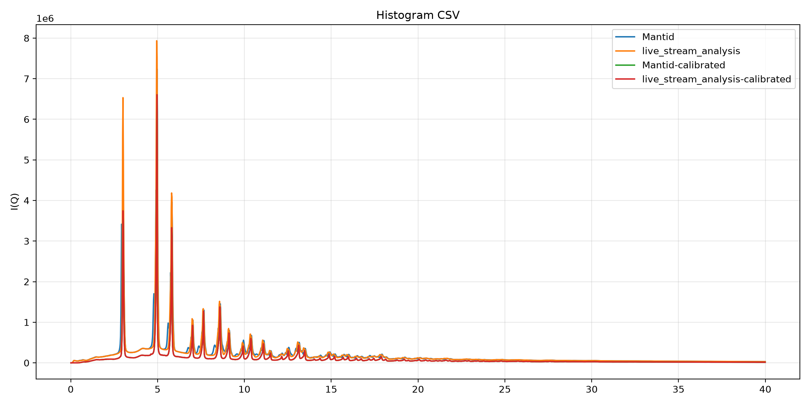
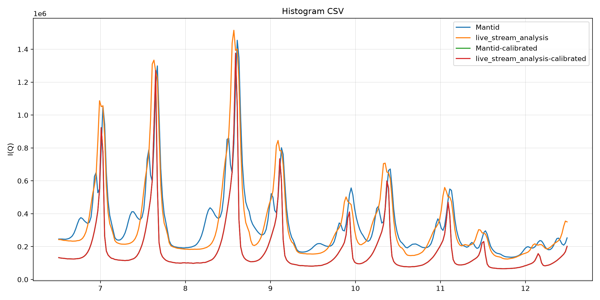
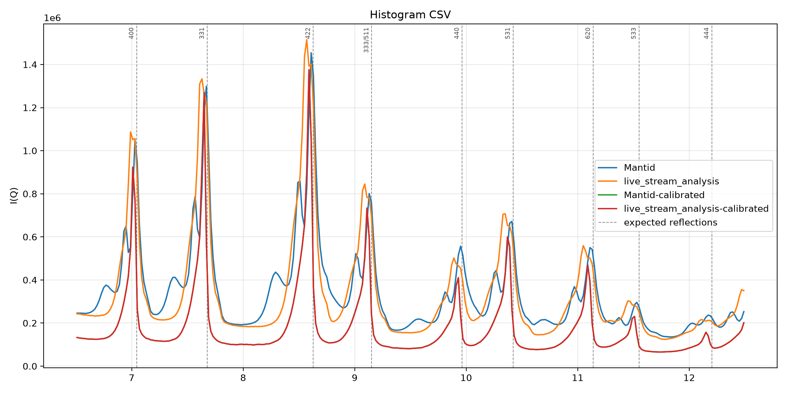

# Mantid live-data comparison scripts

Scripts for checking `live_stream_analysis` against the equivalent Mantid reduction, and for
replaying recorded ADARA data so the live path can be exercised without beam time.

As with `scripts/preparer`, the `live_stream_analysis` package stays pure-Python and does not
declare Mantid as a dependency. Mantid lives in a self-contained pixi environment in this
directory, so it never touches the project's uv environment.

## Contents

| Script | Environment | Purpose |
| --- | --- | --- |
| `adara_replay_server.py` | uv (stdlib only) | Serve recorded `.adara` files over TCP as a fake live stream |
| `mantid_iq_from_nexus.py` | pixi | Reduce a NeXus file to I(Q) with Mantid, in our CSV format |
| `mantid_live_iq.py` | pixi | Drive Mantid's `StartLiveData` against a file replayed inside Mantid |
| `compare_iq.py` | uv (stdlib only) | Diff two histogram CSVs bin-by-bin |
| `diamond_reference.py` | uv (stdlib only) | Generate expected diamond reflections from the lattice parameter |
| `check_diamond_peaks.py` | uv (stdlib only) | Measure observed peak positions against those expected values |

Plotting stays in `scripts/plot_csv_histogram.py`; pass `--with-diamond-reflections` to mark
the expected positions on any of its existing plot modes.

## How our pipeline maps onto Mantid's live-data algorithms

Mantid's live stack is three algorithms: `StartLiveData` is the user-facing entry point, which
launches `MonitorLiveData` as a background job, which calls `LoadLiveData` on a timer. Each
`LoadLiveData` call pulls one chunk of everything since the last call, runs it through an
optional processing step, accumulates it into the output workspace, then optionally
post-processes the accumulated result.

Our analyzer follows the same shape:

| Mantid | `live_stream_analysis` |
| --- | --- |
| `StartLiveData` (entry point) | `live_stream_analysis analyze --adara-stream HOST PORT` |
| `Listener` (`SNSLiveEventDataListener` for ADARA) | `readadara` `AdaraLiveStreamReader` |
| `LoadLiveData` chunk | one ADARA packet from `reader.read_generator()` |
| `ProcessingAlgorithm` (per chunk) | per-event Q = constant / TOF via `pixel_tof_to_q` |
| `AccumulationMethod=Add` | `hist[bin] += 1` |
| `AccumulationWorkspace` | the in-memory `hist` list |
| `PostProcessingAlgorithm` (on accumulated data) | `apply_corrections` (background subtraction, vanadium normalisation) |
| `OutputWorkspace` | histogram CSV, live plot, INTERSECT `histogram.updated` event |
| `RunTransitionBehavior=Restart` | NEW_RUN clears the histogram, END_RUN finalises the run |
| `UpdateEvery` (seconds) | `--live-plot-refresh-every` (packets) and `publish_interval_seconds` (INTERSECT) |
| `PreserveEvents=False` | events are never retained; only the Q histogram |

Differences worth knowing:

- We only implement the equivalent of `AccumulationMethod=Add`. Mantid also offers `Replace`
  (latest chunk wins) and `Append` (chunks extend the workspace as new spectra).
- Mantid's `RunTransitionBehavior` also offers `Stop` and `Rename`; we always restart.
- We refresh on a packet count, Mantid on a wall-clock interval.
- Mantid accumulates into a workspace with full instrument geometry attached, so any Mantid
  algorithm can be applied downstream. We accumulate a flat list of bin counts.

## Set up the Mantid environment (pixi)

Everything is pinned in `pixi.toml` / `pixi.lock` in this directory, so this is one command:

```bash
cd scripts/live_comparison
pixi install
```

`pixi run` then executes inside that environment. Verified with Mantid 6.15.0 on linux-64.
Nothing else on the machine is touched, and no conda/mamba installation is required.

```bash
pixi run python -c "import mantid; print(mantid.__version__)"
```

---

# Walkthrough 1: compare I(Q) against Mantid, from the same NeXus file

This is the meaningful numeric check. Both sides read the same file with the same Q binning.
The walkthrough uses the same data as the notebooks: diamond run 244114 with the 2026-06-09
calibration (243451), the newest one measured before it. NOMAD needs a calibration from the same
sample-environment setup, since the sample position moves each time the environment is swapped.

### 1. Reduce with Mantid

```bash
cd scripts/live_comparison
pixi run python mantid_iq_from_nexus.py \
    --nexus-file ../../nexus_files/diamond/NOM_244114.nxs.h5 \
    --histogram-q-max 40 \
    --histogram-q-bin-size 0.02 \
    --output-csv mantid_iq.csv
```

For the calibrated reduction, add
`--calibration-file ../../nexus_files/calibration/NOMAD_243451_2026-06-09_shifter.h5 --apply-calibration-mask`
and write `mantid_iq_calibrated.csv`. That applies the calibrated DIFC, the same constant the
analyzer uses, and masks the same pixels the analyzer skips. Each reduction of the 3.3 GB
`NOM_244114` takes about a minute.

### 2. Reduce with the analyzer

From the repository root, in the uv environment:

```bash
uv run live_stream_analysis analyze \
    --nexus-file nexus_files/diamond/NOM_244114.nxs.h5 \
    --histogram-pixel-geometry-csv pixel_geometry.csv \
    --histogram-q-max 40 \
    --histogram-q-bin-size 0.02 \
    --normalize-by none \
    --histogram-output-csv scripts/live_comparison/live_stream_analysis_iq.csv
```

`--normalize-by none` keeps raw counts, as Mantid reports them; by default the analyzer divides by
proton charge. For the calibrated reduction, use `pixel_geometry_calibrated.csv` (the preparer
output for the 243451 calibration; see `docs/reference.md`) and write
`live_stream_analysis_iq_calibrated.csv`. Each takes about three to four minutes.

### 3. Diff them

```bash
uv run python scripts/live_comparison/compare_iq.py \
    scripts/live_comparison/mantid_iq_calibrated.csv \
    scripts/live_comparison/live_stream_analysis_iq_calibrated.csv
```

### 4. Plot them together

Both sides emit the project's three-column format, so the existing plotter overlays them.
Running all four reductions -- Mantid and the analyzer, each with and without calibration --
in one figure:

```bash
uv run python scripts/plot_csv_histogram.py \
    ./scripts/live_comparison/mantid_iq.csv --label Mantid \
    --input scripts/live_comparison/live_stream_analysis_iq.csv --label live_stream_analysis \
    --input scripts/live_comparison/mantid_iq_calibrated.csv --label Mantid-calibrated \
    --input scripts/live_comparison/live_stream_analysis_iq_calibrated.csv --label live_stream_analysis-calibrated \
    --mode overlay --x-min 0 --x-max 40 \
    --output-png comparison.png
```



The plotter always opens the interactive matplotlib window, which is the way to zoom around;
`--output-png` also saves a file, and `MPLBACKEND=Agg` skips the window. Narrowing the range
shows where the reductions diverge:

```bash
uv run python scripts/plot_csv_histogram.py \
    ./scripts/live_comparison/mantid_iq.csv --label Mantid \
    --input scripts/live_comparison/live_stream_analysis_iq.csv --label live_stream_analysis \
    --input scripts/live_comparison/mantid_iq_calibrated.csv --label Mantid-calibrated \
    --input scripts/live_comparison/live_stream_analysis_iq_calibrated.csv --label live_stream_analysis-calibrated \
    --mode overlay --x-min 6.5 --x-max 12.5 \
    --output-png comparison-zoomed-in.png
```



The green Mantid-calibrated curve is not missing: it is identical to the red calibrated analyzer
curve, which is drawn over it. The two uncalibrated curves differ, for the geometry reason below.
The calibrated pair has a lower baseline only because masked pixels are dropped.

## What this comparison currently shows

Run on `NOM_244114` (412,374,426 events). **Calibrated on both sides, the two reductions are
identical, bin for bin**:

```
Bins compared        : 2000
Max |dQ|             : 0.000e+00
Total counts         : reference=200438900.0 candidate=200438900.0
  total delta        : +0.0000%
Mean relative dI     : 0.0000%
Bins over tolerance  : 0 (tolerance 1.00%)
```

Both convert each event with `Q = 2*pi*DIFC / TOF`. Mantid's `ConvertUnits` to `MomentumTransfer`
uses DIFC alone after `ApplyDiffCal`; DIFA and TZERO only enter its dSpacing conversion. The
analyzer does the same since issue #42: the preparer writes `2*pi*DIFC` as each pixel's TOF-to-Q
constant, and `difa`/`tzero` are kept in the CSV for reference only. The mask matches too:
`LoadDiffCal`'s mask workspace removes exactly the pixels the preparer marks `use = 0` (69,008
of 101,376 for this calibration), so 200,438,900 events survive on both sides.

Uncalibrated, the two differ:

```
Bins compared        : 2000
Max |dQ|             : 0.000e+00        <- Q axes agree exactly
Total counts         : reference=388223970.0 candidate=388087910.0
  total delta        : -0.0350%
Mean relative dI     : 7.0062%
```

The **Q axes align exactly** and the **totals agree to 0.04%**, but the per-bin distribution
differs by about 7% on average. Overlaying the two shows why: ours are sharper, while Mantid's
peaks are broader and slightly split. That is a geometry-source difference, not a binning bug:
Mantid uses the instrument embedded in the NeXus file, while the analyzer uses
`pixel_geometry.csv` generated from `tests/data/idf/NOMAD_Definition.xml`. Closing that gap means
generating the pixel geometry from the same instrument definition the data file carries.

### Earlier masking discrepancy, resolved

An earlier version of this walkthrough found the totals 12 % apart with the calibration on, and
70 % apart with `--apply-calibration-mask`. It concluded that the mask workspace and the `use`
column were not equivalent on NOMAD. In fact the analyzer's `pixel_geometry_calibrated.csv` had
been built from a different calibration (241348, 2026-05-13) from the one Mantid was given
(243451). With one calibration file on both sides, the two masks agree exactly.

---

# Walkthrough 1b: check peak positions against diamond

Comparing two reductions against each other says whether they agree, not whether either is
right. Diamond gives an absolute reference: it is cubic (Fd-3m) with a well-known lattice
parameter, so its reflection positions follow from `Q = 2*pi*sqrt(h^2+k^2+l^2)/a` and are
fixed independently of any instrument.

`diamond_reflections.csv` is checked in; regenerate it with a different lattice parameter or
Q range like this:

```bash
uv run python scripts/live_comparison/diamond_reference.py --q-max 40
```

It uses a = 3.56712 A (diamond at 298 K, Hom, Kiszenick & Post, *J. Appl. Cryst.* **8**
(1975) 457-458) and the diamond reflection condition: h, k, l all odd, or all even with
h+k+l divisible by 4. That is why 200 and 222 are absent from the data.

Measure a reduction against it:

```bash
uv run python scripts/live_comparison/check_diamond_peaks.py \
    scripts/live_comparison/live_stream_analysis_iq_calibrated.csv
```

Each peak centre is refined with a parabola through the maximum bin and its neighbours, so
the result is not quantised to the bin width.

To see the same thing, add `--with-diamond-reflections` to the usual plotting script. It
works with every existing option, including `--mode subplots`, and leaving off `--output-png`
gives the interactive matplotlib window so you can zoom:

```bash
uv run python scripts/plot_csv_histogram.py \
    ./scripts/live_comparison/mantid_iq.csv --label Mantid \
    --input scripts/live_comparison/live_stream_analysis_iq.csv --label live_stream_analysis \
    --input scripts/live_comparison/mantid_iq_calibrated.csv --label Mantid-calibrated \
    --input scripts/live_comparison/live_stream_analysis_iq_calibrated.csv --label live_stream_analysis-calibrated \
    --mode overlay --x-min 6.5 --x-max 12.5 \
    --with-diamond-reflections --annotate-reflections \
    --output-png comparison-with-reflections.png
```



The dashed lines are fixed by the lattice parameter. All four reductions sit to the left of
them, by different amounts; the table below puts numbers on it.

Related options:

- `--annotate-reflections` labels each marker with its hkl.
- `--reflection-min-intensity` hides weak reflections (default 0.5; lower it to mark more).
- `--reflections-csv PATH` marks a different material's reflections instead of diamond, using
  any CSV with `hkl`, `Q (1/A)` and `rel intensity` columns.

## Result on NOM_243708

Across 21 matched reflection## Result on NOM_244114

Across 21 matched reflections spanning Q = 3 to 18, with the 243451 calibration:

| Reduction | mean dQ (1/A) | RMS dQ | dQ/Q, excluding 111 |
| --- | --- | --- | --- |
| Mantid, uncalibrated | -0.0237 | 0.0260 | -0.19 % (-0.10 to -0.25) |
| Mantid, calibrated (with mask) | -0.0497 | 0.0525 | -0.43 % (-0.35 to -0.45) |
| live_stream_analysis, calibrated | -0.0497 | 0.0525 | -0.43 % (-0.35 to -0.45) |
| live_stream_analysis, uncalibrated | -0.0757 | 0.0818 | -0.67 % (-0.21 to -0.83) |

The two calibrated rows are the same because the histograms are identical. Without
`--apply-calibration-mask`, Mantid calibrated gives -0.0474 1/A: the masked pixels shift the
peak centres slightly.

With the calibration, `dQ/Q` is nearly flat with Q. That is the signature of a scale error: an
effective DIFC, or equivalently a lattice parameter, that is slightly off. A zero offset would
instead show up as a constant `dQ`. So the remaining -0.43 % is the calibration, not the
conversion: both sides apply the same DIFC and get the same answer. The calibration was made ten
days before this run, and NOMAD's sample position moves whenever the sample environment is
swapped, which shifts every pixel's effective DIFC. Uncalibrated, the analyzer's
`pixel_geometry.csv`, built from the static IDF, scatters more (-0.2 % to -0.8 %); that is what
the calibration corrects.

Two caveats:

- **Mantid uncalibrated lands closer than either calibrated reduction** (-0.19 % against
  -0.43 %). It uses the geometry embedded in the NeXus file, which evidently fits this run better
  than the 243451 DIFCs do. A calibration from the same sample-environment setup as the run
  should close this; none newer than 243451 is in `nexus_files/calibration/`.
- The 111 reflection is an outlier in every file (-1.1 % to -1.4 %) while its neighbours are
  consistent. It is by far the strongest and most asymmetric peak, so the parabolic refinement
  is least reliable there; do not read much into that one line.

Before issue #42 the analyzer also applied DIFA and TZERO, through
`TOF = DIFA*d^2 + DIFC*d + TZERO`. On this run that gave a mean dQ of -0.036 1/A and narrower
peaks at high Q, but it no longer matched Mantid's Q conversion. Only the TOF-to-Q constant is
applied now.

## About the intensity column

`rel_intensity` in the reference is a kinematic estimate only: multiplicity x |F|^2 x d^4
(a TOF Lorentz factor) x Debye-Waller with B = 0.20 A^2. It ranks peaks and helps identify
them, but it will not match the data quantitatively -- these histograms are summed over all
detector banks with no vanadium normalisation or absorption correction, so the observed
intensities are dominated by instrument response. The observed pattern has 220 as the tallest
peak while this estimate puts 111 first, which is exactly the kind of disagreement to expect.
**Use the positions for validation; treat the intensities as indicative.**

---

# Walkthrough 2: replay recorded ADARA data as a live stream

`adara_replay_server.py` serves a recorded `.adara` file over TCP. The bytes in an ADARA file
are byte-identical to the bytes on the wire -- `readadara` parses a socket with the same
reader it uses for a file -- so no protocol translation is involved.

This exercises the real `--adara-stream` path: run transitions, reconnects, and INTERSECT
publishing, all from recorded data.

### Run boundaries are spread across files

A single run is split into many files, and only the last carries `END_RUN`. For run 208511:

| File | Run-status packets |
| --- | --- |
| `m00000001-f00000001` | `NEW_RUN(1)`, `RUN_EOF(2)` |
| `m00000001-f00000002` .. `f00000008` | `RUN_BOF(3)`, `RUN_EOF(2)` |
| `m00000001-f00000009` | `RUN_BOF(3)`, **`END_RUN(4)`** |

Pass the whole set to replay a complete run. `RUN_EOF` is not run completion -- only `END_RUN`
finalises, which is why the middle files do not end the run.

### Basic replay

Terminal 1, start the server:

```bash
RUN=adara_mount/20250201/adara_streams/NOMAD.Raw.Data.Runs.208511-208543/20250131-101613.350178410-run-208511
uv run python scripts/live_comparison/adara_replay_server.py \
    --adara-file $RUN/m00000001-f*.adara \
    --port 31415 --log-every 20000
```

Terminal 2, point the analyzer at it:

```bash
uv run live_stream_analysis analyze \
    --adara-stream 127.0.0.1 31415 \
    --histogram-pixel-geometry-csv pixel_geometry_calibrated.csv \
    --histogram-q-max 40 --histogram-q-bin-size 0.02 \
    --live-plot-mode browser --live-plot-keep-open \
    --histogram-output-csv /tmp/stream_iq.csv
```

The full nine-file run is roughly 1.9 GB / 235M events and takes a while. For a quick check,
replay only `f00000001` and `f00000009` -- that still spans `NEW_RUN` to `END_RUN`.

Add `--packets-per-second 200` to make it behave like a slow beamline rather than replaying
as fast as the socket allows.

### Testing reconnect

`--drop-after N` cuts the connection after N packets, and `--drop-once` applies that to the
first client only, so the reconnecting client gets a clean run through to `END_RUN`:

```bash
uv run python scripts/live_comparison/adara_replay_server.py \
    --adara-file $RUN/m00000001-f00000009-run-208511.adara \
    --port 31415 --drop-after 300 --drop-once
```

```bash
uv run live_stream_analysis analyze \
    --adara-stream 127.0.0.1 31415 \
    --histogram-pixel-geometry-csv pixel_geometry_calibrated.csv \
    --histogram-q-max 40 --histogram-q-bin-size 0.02 \
    --adara-stream-max-reconnects 3 --adara-stream-reconnect-delay 2 \
    --histogram-output-csv /tmp/reconnect_iq.csv
```

Pick a `--drop-after` smaller than the file's packet count or it never fires: `f00000009` is
only 780 packets, while `f00000001` is 8,994.

This is how the mid-stream reconnect bug was found. A reset used to reach the top-level
`OSError` handler and kill the analyzer, because only a *clean* end of stream reached the
reconnect path. `tests/unit/analyzer/test_adara_reconnect.py` now covers both that case and a
refused reconnect.

### Note on reconnect semantics

On reconnect the server replays from the beginning of its file list, whereas a real SMS would
continue from wherever the stream had reached. That is fine for exercising the reconnect and
run-transition logic, but it means the accumulated histogram after a reconnect double-counts
the replayed portion. Do not read physics into a histogram from a run that reconnected.

---

# Walkthrough 3: Mantid's own live pipeline, from a file

Mantid can replay a file through its full live stack using the `ADARA_FileReader` instrument
in the `TEST_LIVE` facility. This runs **inside Mantid** and opens no socket, so it does not
consume `adara_replay_server.py`; the two are independent demonstrations.

Point Mantid at the file to replay by adding to `~/.mantid/Mantid.user.properties`:

```
fileeventdatalistener.filename=NOM_243708.nxs.h5
fileeventdatalistener.chunks=100
```

The file must sit in one of Mantid's configured data search directories. Then:

```bash
cd scripts/live_comparison
pixi run python mantid_live_iq.py --output-csv /tmp/mantid_live_iq.csv
```

Comparing that against the analyzer's single-pass reduction of the same file checks that
chunked `Add` accumulation converges on the same I(Q).

`mantid_live_iq.py` has **not** been run end to end -- it needs the `Mantid.user.properties`
entry above and a `TEST_LIVE` facility setting, which were not configured here. Treat its
`StartLiveData` call as a starting point. `mantid_iq_from_nexus.py` and `compare_iq.py` have
both been run against real data.

## ADARA vs NeXus on the same run

Diamond run 244114 (IPTS-37098, 2026-06-19) exists in both formats: `nexus_files/diamond/NOM_244114.nxs.h5`
and the ADARA run directory on the carbon NFS share. Reducing both with the 2026-06-09 calibrated
geometry and no corrections, NeXus with `--tof-tick-us 1.0` and ADARA with `--tof-tick-us 0.1`:

| Check | NeXus (412 M events) | ADARA first file (26 M events) |
| --- | --- | --- |
| Mean dQ against the diamond lattice, 21 reflections | -0.0497 1/A | -0.0486 1/A |
| Peak centres, ADARA minus NeXus, 11 strong peaks | | mean +0.0007 1/A, max 0.0016 1/A |
| Relative RMS shape difference, Q 1-20 (each scaled to unit total) | | 1.5 % |

The two paths put every peak in the same place, to under a tenth of a 0.02 bin. The nearly
constant -0.43 % offset that both share is the calibration, which predates this run by ten days
(Walkthrough 1b). The 1.5 % shape difference is nearly four times what counting noise alone
predicts (0.4 %). The ADARA file covers only the first 18 s of the 288 s run, so it may reflect a
change over the run rather than a difference between the two paths; it has not been run down.

Peak centres and the shape difference use the definitions in
`scripts/tutorial_dataset/trim_study.py` (`peak_centres`, and R over Q 1-20). Both reductions ran
with `--normalize-by none`, and the ADARA one with:

```bash
uv run live_stream_analysis analyze \
    --adara-file nomad-adara-carbon-share/20260619-140639.403016382-run-244114/m00000001-f00000001-run-244114.adara \
    --histogram-pixel-geometry-csv pixel_geometry_calibrated.csv --tof-tick-us 0.1 \
    --histogram-q-max 40 --histogram-q-bin-size 0.02 --normalize-by none \
    --histogram-output-csv /tmp/adara_f1_iq.csv
```
