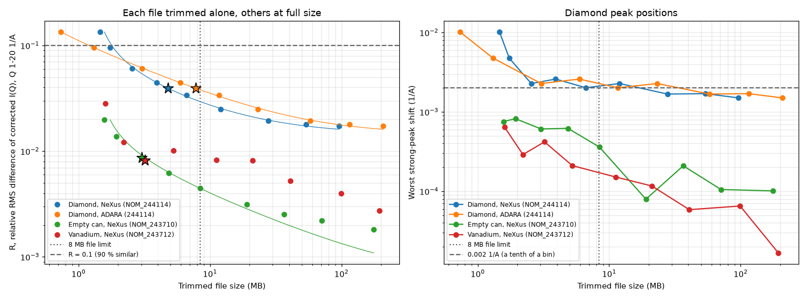
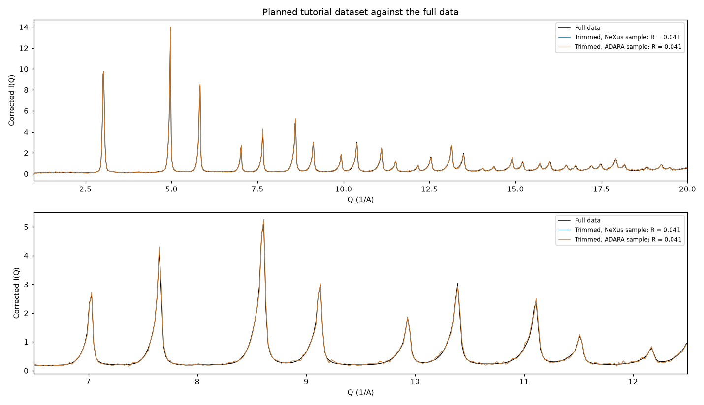

# Tutorial dataset: how small can the data be?

The walkthrough notebooks and CI need input data that fits in the repository, where
`check-added-large-files` caps every file at 8 MB. This directory trims the real NOMAD runs to
the first part of each run, and measures how much of the full-data result each trimmed size
keeps.

| File | Contents |
| --- | --- |
| `trim.py` | Trim a NeXus file or an ADARA run to its first N pulses |
| `trim_study.py` | The study below: trim at many sizes, compare with the full data, pick sizes |
| `results/sweep.csv` | Every trim measured: pulses, bytes, events, and the metrics below |
| `results/summary.json` | Noise fits, and the chosen trims with their combined result |
| `results/similarity_vs_size.png` | Similarity and peak shift against file size, per file |
| `results/planned_vs_full.png` | The chosen dataset's corrected I(Q) against the full data |

## Trimming by time

A trimmed file is the start of its run, not a thinned copy of the whole run, so it is honestly a
shorter run:

- **NeXus:** each `bankN_events` group keeps the events of its first N pulses, cut at
  `event_index[N]`. All 101 banks share one pulse timeline, and the per-pulse
  `DASlogs/proton_charge` log sums exactly to `entry/proton_charge`. So the trimmed charge is the
  sum of the kept pulses, and the duration is N/60 s. User groups are dropped and the event arrays
  are gzip-compressed.
- **ADARA:** the packets of the run's first file up to its (N+1)th RTDL packet, which is one per
  pulse, followed by the END_RUN packet from the run's last file. The result is a complete
  NEW_RUN-to-END_RUN run, copied byte for byte.

Trimmed to the same pulses, the two formats of run 244114 hold the same events (1,432,630 in the
first 60 pulses) and the same charge, and histogram identically apart from single counts at
bin edges.

## Method

Each file is trimmed alone to 9 log-spaced sizes, with the other two inputs at full size:

| File | Full run | Trims |
| --- | --- | --- |
| Diamond, NeXus `NOM_244114` | 288.7 s, 0.40 C | 3 to 1,080 pulses (0.05 to 18 s) |
| Diamond, ADARA run 244114 | the same run | 3 to 1,080 pulses, from its first file |
| Empty PAC06 can, NeXus `NOM_243710` | 1,442.6 s, 2.0 C | 30 to 15,000 pulses |
| Vanadium rod, NeXus `NOM_243712` | 1,443.9 s, 2.0 C | 6 to 3,000 pulses |

The reference is the full data: all of run 244114, both empty-can runs (243710 and 243711) and
the whole vanadium run. Every combination is reduced to the analyzer's corrected I(Q) with the
package's own `apply_corrections`, so samples are histogrammed once and recombined offline. That
offline reference matches the corrected I(Q) the analyzer writes to within 4 × 10⁻¹⁰.

Each result is compared with the reference by:

- **R**, the relative RMS difference of the corrected I(Q) over Q 1-20 1/Å, with
  similarity = 1 − R;
- the **largest shift** among the 11 strong diamond peaks below Q 18, using baseline-subtracted
  centroids in fixed ±0.12 1/Å windows around the full-data positions.

## Results



- **The sample sets the similarity.** Its R falls as 1/√N, doubling the events gives a 1.41×
  smaller R, down to a floor near 1.5 % (fit: R² = 24.8²/N + 0.0145²). The floor is the start of
  the run against the whole run: even the first 18 s differ from all 288 s by that much. So a trim
  from the start of this run cannot be more than about 98.3 % similar, whatever its size.
- **Background and vanadium hardly matter.** At only 3 MB each, they add R ≈ 0.009 against the
  sample's 0.04. The empty can follows 1/√N; the vanadium does not, because the preparer smooths
  it and strips its peaks, so its noise is not counting-limited.
- **Peak positions have their own floor** of about 0.0015 1/Å, again from the start-of-run
  difference. From 15 pulses up the worst shift stays between 0.0015 and 0.0026 1/Å, a tenth of a
  0.02 bin.
- **ADARA costs twice the bytes of NeXus** for the same events: 16.6 bytes per histogrammed event
  uncompressed, against 7.6 for gzip-compressed NeXus. Each NeXus file also carries 1.3 to 1.6 MB
  of fixed HDF5 overhead from its 101 bank groups, so below about 2 MB nothing is saved.

## Chosen sizes

Since the sample dominates, it gets as many pulses as the ADARA file can hold under the 8 MB cap
(with a 5 % margin), the same for both formats so they carry identical events. Each correction
gets the smallest trim that adds at most 5 % to the sample's R:

| File | Pulses | Run time | Size | R alone |
| --- | --- | --- | --- | --- |
| Diamond, NeXus `NOM_244114` | 40 | 0.67 s | 4.80 MB | 0.039 |
| Diamond, ADARA 244114 | 40 | 0.67 s | 7.85 MB | 0.039 |
| Empty can, NeXus `NOM_243710` | 150 | 2.5 s | 3.03 MB | 0.009 |
| Vanadium, NeXus `NOM_243712` | 30 | 0.5 s | 3.22 MB | 0.008 |

Combined as the notebooks combine them, either sample with that background and vanadium gives
**R = 0.041, 95.9 % similar** to the full data, with every strong peak within 0.0020 1/Å of its
full-data position. The four files total 18.9 MB. Doubling the background and vanadium to about
7 MB each changes R by less than 0.001, so they are not worth the space.



A 40-pulse run lasts 0.67 s, so its error-decay series needs a sampling interval well below the
analyzer's 1 s default: `--statistics-sample-interval-seconds 0.02` gives 21 samples, with mean
σ/I falling from 2.4 to 0.11.

## Re-running

The study reads `nexus_files/` and the carbon NFS share, and the calibrated geometry and diamond
reflections from `notebooks/output/`, so run a `01_preparer` notebook first.

```bash
uv run --group jupyter python scripts/tutorial_dataset/trim_study.py --work-dir /path/to/scratch
```

The first run writes about 1.4 GB of trims to the work directory and takes about 20 minutes.
Later runs reuse what is there and take under a minute.
